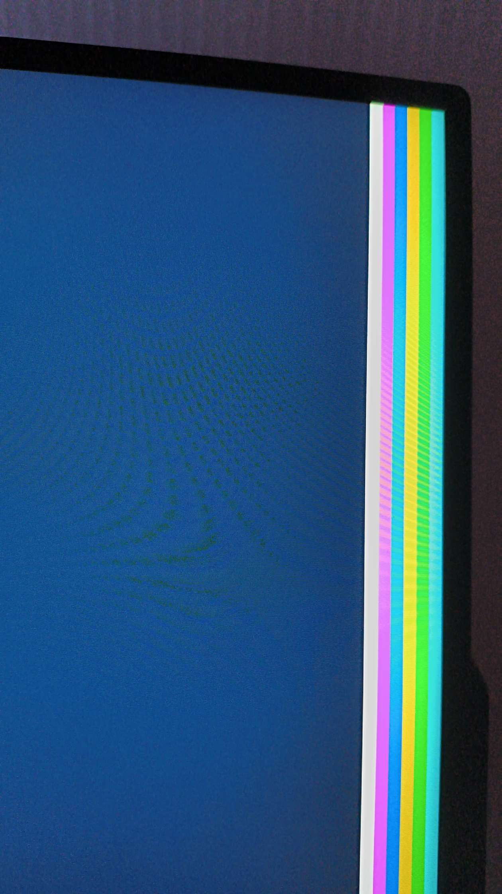

# Preuves de validation physique

## Démarrage physique P1 — 13 octobre 2026

- **Machine :** Lenovo LOQ 15IAX9 (modèle indiqué par l'utilisateur).
- **CPU :** Intel Core i5-12450HX.
- **Mémoire :** 24 Go DDR5.
- **GPU utilisé :** NVIDIA GeForce RTX 4050 dédiée ; le GPU intégré au CPU n'est pas utilisé pour cet essai, selon l'utilisateur.
- **Résultats rapportés :** 5/5 démarrages à froid et 5/5 redémarrages à chaud atteignent la bande blanche finale ; retour au firmware puis au système habituel sans problème.
- **Commit ayant produit les binaires USB testés :** `cb5c676a9adbd0a9cf0e7a4ef69224b4a8729ecc`.
- **Artefact GitHub Actions :** [archiaos-p0-usb-x86_64](https://github.com/Likounsee/ArchiaOS/actions/runs/38432842691).
- **Version BIOS/UEFI :** à relever.

Les SHA-256 du noyau et du chargeur extraits de l'artefact correspondent à ceux présents sur la clé USB. Les résultats de démarrage sont rapportés par l'utilisateur. La bande blanche indique que le chemin d'auto-tests antérieurs a été atteint si elle provient bien de ce build ; elle ne prouve pas la correction exhaustive du noyau.

Cette image est archivée comme pièce de preuve visuelle. La clôture de P1 dépend encore de la confirmation que la photo montre de façon suffisamment lisible la séquence attendue et de la consignation du firmware UEFI/BIOS, ainsi que de la vérification des critères d'acceptation restants.
